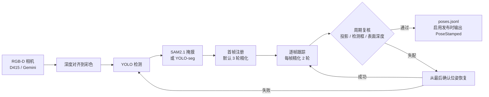

<div align="center">

# fdpose

**Jetson 上的零件 6D 位姿估计与跟踪，支持 RGB-D 输入、桌面预览和 ROS 2 位姿发布**


[ROS 2 启动](src/fdpose_bringup/README.md) · [上游 FoundationPose](https://github.com/NVlabs/FoundationPose)

</div>

**fdpose** 把 [FoundationPose](https://github.com/NVlabs/FoundationPose)（CVPR 2024）接到真实相机上：给定零件 CAD 模型，**YOLO 检测 + SAM2.1** 生成掩膜，首帧注册后逐帧跟踪，并周期复核投影、检测框与模型表面深度；失配时先从最后确认位姿恢复，失败再重新检测注册。相机支持 **RealSense D415** 与 **Orbbec Gemini 336L / 335L**，桌面预览与无头 ROS 2 节点共用同一套 `PosePipeline`。

> **范围**：只做视觉估计，不启动机械臂控制器、不发送运动指令。绝对 6D 精度尚未独立验证。



## 安装

需要 Jetson AGX Orin（aarch64）和 Miniforge。部署脚本按 `/etc/nv_tegra_release` 选择依赖，在 `~/miniforge3/envs/fdpose` 创建独立 Conda 环境。若已有不匹配的环境，请用 `CONDA_ENV` 指定新路径，并用 `FDPOSE_PYTHON` 指向其中的 Python；脚本不会原地升级旧环境的 Python。

| 系统 | CUDA | Conda Python | ROS 2（ROS 模式） |
| --- | --- | --- | --- |
| L4T R39 / Ubuntu 24.04 | 13.2 | 3.12 | Jazzy |
| L4T R36 / Ubuntu 22.04 | 12.6 | 3.10 | Humble |

在仓库根目录执行以下命令。`jetson_setup.sh all` 检出并修补 FoundationPose、准备 Conda 环境并编译扩展。

```bash
bash scripts/jetson_setup.sh all
```

如果使用 Gemini 或通过 ROS 2 launch 启动位姿节点，先按 [上游版本清单](config/upstream.json) 将 Orbbec 驱动放到 `third_party/OrbbecSDK_ROS2`，再按下方命令构建工作区。仅用 D415 桌面脚本可跳过 ROS 2 构建。

```bash
source /opt/ros/jazzy/setup.bash  # R36 改为 /opt/ros/humble/setup.bash
export FDPOSE_ROOT="$PWD"
colcon build --symlink-install --base-paths src third_party/OrbbecSDK_ROS2 --packages-up-to fdpose_bringup
source install/local_setup.bash
```

<details>
<summary><b>运行前必须就位的资产</b>（体积大，不入库）</summary>

| 路径 | 内容 |
| --- | --- |
| `weights/best.pt` | 默认是 YOLO 检测权重。使用 `--mask-backend yolo-seg` 时传入 YOLO 分割权重 |
| `weights/sam2.1_hiera_small.pt` | SAM2.1 检查点（`--mask-backend sam2` 时必需） |
| `third_party/FoundationPose/weights/` | 另行准备 FoundationPose 上游模型权重并保持原目录结构 |
| `third_party/sam2` | 固定版本的 SAM2 源码，使用默认的 SAM2 掩膜后端时需要 |
| `third_party/OrbbecSDK_ROS2` | Orbbec ROS 2 驱动 v1.5.21（含 aarch64 SDK 库），构建上述 ROS 2 工作区时需要 |

部署脚本从固定提交构建 PyTorch3D 和 nvdiffrast。上游提交见 [config/upstream.json](config/upstream.json)，FoundationPose 补丁见 [patches/README.md](patches/README.md)，依赖约束见 [config/runtime-jetson.txt](config/runtime-jetson.txt)。启动脚本默认使用 Conda 环境，也可用 `FDPOSE_PYTHON` 覆盖解释器。两处易踩的坑：`opencv-python-headless` 必须 5.x（4.14 在 `draw_xyz_axis` 的 `tipLength=0` 上断言失败）；`warp-lang` 固定 1.9.1（1.19.0 自带 CUDA 13.4，会判 Orin 驱动不足而退回 CPU）。

</details>

## 快速开始

### 桌面预览

**Gemini 336L / 335L** —— 桌面终端，一条命令拉起相机驱动 + 位姿程序，默认原生 1280×720@30：

```bash
bash scripts/run_330s.sh
```

**RealSense D415** —— 桌面终端，默认 640×480@30：

```bash
bash scripts/run_d415.sh
```

让目标完整入镜（`Aim at the target` 表示未检测到，`Target clipped` 表示目标贴边），按 **Q** 或 **Esc** 退出。Gemini 脚本默认使用序列号 `CPCD7530009J`，可用 `ORBBEC_SERIAL` 覆盖。D415 脚本默认使用 `349222063070`，可追加 `--serial` 参数覆盖。两个脚本默认将位姿写入文件，追加 `--ros-pose-topic /fdpose/pose` 可启用 ROS 2 发布。D415 桌面脚本启用发布时，先在当前终端加载 ROS 2 环境。

### 无头运行（SSH 或无显示器）

每个终端都先进入仓库根目录，再加载环境：

```bash
source /opt/ros/jazzy/setup.bash  # R36 改为 /opt/ros/humble/setup.bash
source install/local_setup.bash
export FDPOSE_ROOT="$PWD"
```

**Gemini** 在第一个终端启动驱动。将 `serial_number` 替换成实际设备的序列号：

```bash
export ROS_DOMAIN_ID=117 ROS_LOCALHOST_ONLY=1
ros2 launch orbbec_camera gemini_330_series.launch.py \
  camera_name:=gemini serial_number:=CPCD7530009J \
  color_width:=1280 color_height:=720 color_fps:=30 \
  depth_width:=1280 depth_height:=720 depth_fps:=30 \
  depth_registration:=true align_mode:=SW enable_frame_sync:=true \
  frame_aggregate_mode:=full_frame enable_depth_scale:=true \
  publish_tf:=false trigger_out_enabled:=false
```

驱动启动后，在第二个终端使用相同的 ROS 域和相机序列号启动位姿节点：

```bash
export ROS_DOMAIN_ID=117 ROS_LOCALHOST_ONLY=1
ros2 launch fdpose_bringup fdpose_live.launch.py serial:=CPCD7530009J frames:=0 \
  output:="artifacts/gemini-node-$(date +%Y%m%d-%H%M%S)"
```

**D415** 直连取流，可直接启动位姿节点。将 `serial` 替换成实际设备的序列号：

```bash
ros2 launch fdpose_bringup fdpose_live.launch.py camera:=d415 serial:=349222063070 frames:=0 \
  output:="artifacts/d415-node-$(date +%Y%m%d-%H%M%S)"
```

在另一个终端用 `ros2 topic echo /fdpose/pose --once` 查看一条位姿消息。先加载上面的 ROS 环境，使用与位姿节点相同的 ROS 域设置。

## 用法

### ROS 2 启动

唯一 launch 是 `fdpose_live.launch.py`，运行桌面 CLI 但不加 `--show`，因此默认无头。`camera` 选 `orbbec-ros`（默认，需先启动 Orbbec 驱动）或 `d415`（直连，无需驱动）。

公共参数：`serial`、`output`（必填）、`camera`、`project_root`、`python`、`mesh`、`geometry`、`weights`、`pose_topic`、`camera_namespace`、`frames`（`0` 为持续运行）。全部参数用 `--show-args` 查看，话题与坐标系约定见 [fdpose_bringup](src/fdpose_bringup/README.md)。

`/fdpose/pose` 发布 `geometry_msgs/msg/PoseStamped`，等价于 JSON 里的 `T_camera_target_m`：平移单位米，四元数 x/y/z/w。Gemini 用彩色光学坐标系与采集时间戳，D415 用 `camera_color_optical_frame` 与主机读帧时刻。**丢失期间停止发布**，订阅端应检查时间戳判断数据是否过期。

### CLI 参数

入口 [live_pose.py](src/fdpose_perception/fdpose_perception/live_pose.py)，两个启动脚本都是它的薄封装，可直接追加参数：

```bash
bash scripts/run_d415.sh --stream-width 1280 --stream-height 720
bash scripts/run_330s.sh --mask-backend yolo-seg --weights weights/seg.pt
```

<details>
<summary><b>全部 CLI 参数</b></summary>

| 参数 | 默认 | 说明 |
| --- | --- | --- |
| `--mesh` / `--geometry` / `--weights` / `--serial` / `--output` | 必填 | 网格、网格→目标变换 JSON、YOLO 权重、相机序列号、输出目录（须不存在） |
| `--camera` | `d415` | `d415` 或 `orbbec-ros` |
| `--camera-namespace` | `/gemini` | Orbbec 话题命名空间 |
| `--mask-backend` | `sam2` | `sam2` 或 `yolo-seg` |
| `--foundationpose` | `third_party/FoundationPose` | FoundationPose 源码目录 |
| `--sam2-checkpoint` | `weights/sam2.1_hiera_small.pt` | `sam2` 后端使用的检查点 |
| `--class-id` / `--mesh-units` | `0` / `mm` | 目标类别 ID、网格单位 |
| `--frames` | `60` | 初始化后跟踪帧数，`0` 为持续运行 |
| `--stream-width` / `--stream-height` | `640` / `480` | D415 取流分辨率 |
| `--init-width` | `640` | 注册时 RGB / 深度 / 掩膜的降采样宽度 |
| `--est-refine-iter` | `3` | 注册精化轮数，上游官方默认 5 |
| `--show` | 关 | 桌面预览，需要 `DISPLAY` |
| `--ros-pose-topic` | 关 | 传入绝对话题名即开启 `PoseStamped` 输出 |

`--foundationpose` 和 `--sam2-checkpoint` 的默认路径相对于 `FDPOSE_ROOT`。直接运行 CLI 时，若未设置该变量，则以源码所在的仓库根目录为准。

预览是单窗口。Gemini 走独立进程显示推理源帧，字幕带状态、源帧号与 ROS 时间戳，队列容量 1，丢帧不阻塞推理；D415 走进程内 tkinter，状态显示在窗口标题。`summary.json` 中 `preview_fps` 是画面刷新速度（仅 Gemini 有），`tracking_fps` 是位姿输出速度。

</details>

## 输出

桌面脚本默认将 D415 输出写入 `artifacts/d415-live-*`，Gemini 输出写入 `artifacts/gemini-330s-*/poses/`。Gemini 桌面脚本的驱动日志位于同次运行目录的 `camera.log`。ROS 2 launch 将结果写入 `output` 指定的目录。

| 文件 | 内容 |
| --- | --- |
| `poses.jsonl` | 每输出帧的 `T_camera_target_m`，平移单位米 |
| `initial_mask.jpg` | 首次通过注册检查的掩膜叠加图 |
| `first_pose.jpg`、`last_pose.jpg` | 首尾位姿叠加图 |
| `summary.json` | 注册耗时、跟踪帧率、延迟分位数、复核 / 恢复 / 重置次数 |
| `drift/<帧号>/` | 复核失配现场：前后 RGB-D、内参、候选与恢复位姿、验证指标 |

失配现场可离线回放，默认在原生分辨率与 640 像素宽度下分别跟踪、复核并计时：

```bash
python src/fdpose_perception/fdpose_perception/replay_drift.py <漂移目录> --output <结果.json>
```

<details>
<summary><b>目录结构</b></summary>

```text
src/
  fdpose_perception/          ROS 2 感知包
    fdpose_perception/        Python 实现
      live_pose.py            实时位姿入口
      replay_drift.py         离线漂移回放入口
      camera.py               RGB-D 接口、D415 取流与相机校正
      orbbec_ros.py           Orbbec ROS 2 RGB-D 同步取流
      tracking.py             位姿流程、投影几何与跟踪复核
      recording.py            位姿、漂移和 JSON 写入
      preview.py              桌面预览
      adapters/               检测、FoundationPose 与 ROS 2 发布适配
  fdpose_bringup/             ROS 2 launch 组合启动
scripts/                      Jetson 部署 · 桌面启动入口
config/                       运行时约束、上游版本、几何配置、mesh/ 零件网格
patches/                      上游适配补丁
```

`third_party/` 按固定版本清单部署，运行输出写入 `artifacts/`，两者都不入库。lint 只查语法级错误：`ruff check .`。

</details>

## 许可与引用

**本仓库自身许可尚未声明**，在明确选择许可证之前不应假定代码可被再分发或用于商业用途。

本工程围绕 NVlabs FoundationPose 构建，若对你有帮助请引用上游论文：

```bibtex
@inproceedings{wen2024foundationpose,
  title     = {FoundationPose: Unified 6D Pose Estimation and Tracking of Novel Objects},
  author    = {Wen, Bowen and Yang, Wei and Kautz, Jan and Birchfield, Stan},
  booktitle = {CVPR},
  pages     = {17868--17879},
  year      = {2024}
}
```
