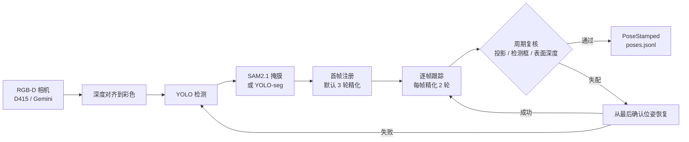

<div align="center">

# fdpose

**Jetson 上的零件 6D 位姿估计与跟踪 —— RGB-D 进，ROS 2 `PoseStamped` 出**


[ROS 2 启动](src/fdpose_bringup/README.md) · [上游 FoundationPose](https://github.com/NVlabs/FoundationPose)

</div>

**fdpose** 把 [FoundationPose](https://github.com/NVlabs/FoundationPose)（CVPR 2024）接到真实相机上：给定零件 CAD 模型，**YOLO 检测 + SAM2.1** 生成掩膜，首帧注册后逐帧跟踪，并周期复核投影、检测框与模型表面深度；失配时先从最后确认位姿恢复，失败再重新检测注册。相机支持 **RealSense D415** 与 **Orbbec Gemini 336L / 335L**，桌面预览与无头 ROS 2 节点共用同一套 `PosePipeline`。

> **范围**：只做视觉估计，不启动机械臂控制器、不发送运动指令。绝对 6D 精度尚未独立验证。



## 安装

需要 Jetson AGX Orin（JetPack 6.2 / CUDA 12.6 / Ubuntu 22.04 aarch64）、ROS 2 Humble、Python 3.10 虚拟环境。

```bash
cd ~/fdonpose-git
REPO="$PWD/third_party/FoundationPose" VENV="$HOME/venvs/ev-charging-d415-gpu" \
PATCH="$PWD/patches/0001-platform-compat.patch" REQ="$PWD/config/runtime-jetson.txt" \
WORK="$HOME/foundationpose-deploy" bash scripts/jetson_setup.sh all

source /opt/ros/humble/setup.bash
export FDPOSE_ROOT="$PWD"
colcon build --symlink-install --base-paths src third_party/OrbbecSDK_ROS2 --packages-up-to fdpose_bringup
source install/local_setup.bash
```

<details>
<summary><b>运行前必须就位的资产</b>（体积大，不入库）</summary>

| 路径 | 内容 |
| --- | --- |
| `weights/best.pt` | YOLO 检测或分割权重 |
| `weights/sam2.1_hiera_small.pt` | SAM2.1 检查点（`--mask-backend sam2` 时必需） |
| `third_party/FoundationPose` | 固定提交 + [适配补丁](patches/README.md)，含上游 `weights/`、`demo_data/` |
| `third_party/pytorch3d`、`third_party/nvdiffrast` | 固定提交，源码构建 |
| `third_party/sam2` | SAM2 源码 |
| `third_party/OrbbecSDK_ROS2` | Orbbec ROS 2 驱动 v1.5.21（含 aarch64 SDK 库），随项目 colcon 构建，不装系统目录 |

上游提交见 [config/upstream.json](config/upstream.json)，依赖约束见 [config/runtime-jetson.txt](config/runtime-jetson.txt)。两处易踩的坑：`opencv-python-headless` 必须 5.x（4.14 在 `draw_xyz_axis` 的 `tipLength=0` 上断言失败）；`warp-lang` 固定 1.9.1（1.19.0 自带 CUDA 13.4，会判 Orin 驱动不足而退回 CPU）。

</details>

## 快速开始

**Gemini 336L / 335L** —— 桌面终端，一条命令拉起相机驱动 + 位姿程序，默认原生 1280×720@30：

```bash
bash scripts/run_330s.sh
```

**RealSense D415** —— 桌面终端，默认 640×480@30：

```bash
bash scripts/run_d415.sh
```

**无头运行** —— SSH / 无显示器。Gemini 先启动 Orbbec 驱动，再在同一 ROS 域运行；D415 直连，加 `camera:=d415` 即可：

```bash
ros2 launch fdpose_bringup fdpose_live.launch.py serial:=CPCD7530009J frames:=0 \
  output:="artifacts/gemini-node-$(date +%Y%m%d-%H%M%S)"
ros2 topic echo /fdpose/pose --once
```

让目标完整入镜（`Aim at the target` = 未检测到，`Target clipped` = 贴边），按 **Q** / **Esc** 退出。默认序列号 D415 `349222063070`、Gemini `CPCD7530009J`，后者用 `ORBBEC_SERIAL` 覆盖。

## 用法

### ROS 2 启动

唯一 launch 是 `fdpose_live.launch.py`，运行桌面 CLI 但不加 `--show`，因此默认无头。`camera` 选 `orbbec-ros`（默认，需先启动 Orbbec 驱动）或 `d415`（直连，无需驱动）。

公共参数：`serial`、`output`（必填）、`camera`、`project_root`、`python`、`mesh`、`geometry`、`weights`、`pose_topic`、`camera_namespace`、`frames`（`0` 为持续运行）。全部参数用 `--show-args` 查看，话题与坐标系约定见 [fdpose_bringup](src/fdpose_bringup/README.md)。

`/fdpose/pose` 发布 `geometry_msgs/msg/PoseStamped`，等价于 JSON 里的 `T_camera_target_m`：平移单位米，四元数 x/y/z/w。Gemini 用彩色光学坐标系与采集时间戳，D415 用 `camera_color_optical_frame` 与主机读帧时刻。**丢失期间停止发布**，订阅端应检查时间戳判断数据是否过期。

### 桌面 CLI

入口 [live_pose.py](src/fdpose_perception/fdpose_perception/live_pose.py)，两个启动脚本都是它的薄封装，可直接追加参数：

```bash
bash scripts/run_d415.sh --stream-width 1280 --stream-height 720
bash scripts/run_330s.sh --mask-backend yolo-seg --weights weights/seg.pt
```

<details>
<summary><b>全部 CLI 参数</b></summary>

| 参数 | 默认 | 说明 |
| --- | --- | --- |
| `--mesh` / `--geometry` / `--weights` / `--serial` / `--output` | 必填 | 网格、网格→目标变换 JSON、YOLO 权重、相机序列号、输出目录（须不存在） |
| `--camera` | `d415` | `d415` 或 `orbbec-ros` |
| `--camera-namespace` | `/gemini` | Orbbec 话题命名空间 |
| `--mask-backend` | `sam2` | `sam2` 或 `yolo-seg` |
| `--class-id` / `--mesh-units` | `0` / `mm` | 目标类别 ID、网格单位 |
| `--frames` | `60` | 初始化后跟踪帧数，`0` 为持续运行 |
| `--stream-width` / `--stream-height` | `640` / `480` | D415 取流分辨率 |
| `--init-width` | `640` | 注册时 RGB / 深度 / 掩膜的降采样宽度 |
| `--est-refine-iter` | `3` | 注册精化轮数，上游官方默认 5 |
| `--show` | 关 | 桌面预览，需要 `DISPLAY` |
| `--ros-pose-topic` | 关 | 传入绝对话题名即开启 `PoseStamped` 输出 |

预览是单窗口。Gemini 走独立进程显示推理源帧，字幕带状态、源帧号与 ROS 时间戳，队列容量 1，丢帧不阻塞推理；D415 走进程内 tkinter，状态显示在窗口标题。`summary.json` 中 `preview_fps` 是画面刷新速度（仅 Gemini 有），`tracking_fps` 是位姿输出速度。

</details>

## 输出

D415 写入 `artifacts/d415-live-*`，Gemini 写入 `artifacts/gemini-330s-*/poses/`，驱动日志在同次运行目录的 `camera.log`。

| 文件 | 内容 |
| --- | --- |
| `poses.jsonl` | 每输出帧的 `T_camera_target_m`，平移单位米 |
| `initial_mask.jpg` | 首次通过注册检查的掩膜叠加图 |
| `first_pose.jpg`、`last_pose.jpg` | 首尾位姿叠加图 |
| `summary.json` | 注册耗时、跟踪帧率、延迟分位数、复核 / 恢复 / 重置次数 |
| `drift/<帧号>/` | 复核失配现场：前后 RGB-D、内参、候选与恢复位姿、验证指标 |

失配现场可离线回放，默认在原生分辨率与 640 像素宽度下分别跟踪、复核并计时：

```bash
python src/fdpose_perception/fdpose_perception/replay_drift.py <漂移目录> --output <结果.json>
```

<details>
<summary><b>目录结构</b></summary>

```text
src/
  fdpose_perception/  相机接入 · 几何 · 流程 · 复核 · 记录 · 预览 · 适配层 · CLI · 漂移回放
  fdpose_bringup/     launch 组合启动
scripts/              Jetson 部署 · 桌面启动入口
config/               运行时约束、上游版本、几何配置、mesh/ 零件网格
patches/              上游适配补丁
```

`third_party/` 按固定版本清单部署，运行输出写入 `artifacts/`，两者都不入库。lint 只查语法级错误：`ruff check .`。

</details>

## 许可与引用

**本仓库自身许可尚未声明**，在明确选择许可证之前不应假定代码可被再分发或用于商业用途。

本工程围绕 NVlabs FoundationPose 构建，若对你有帮助请引用上游论文：

```bibtex
@inproceedings{wen2024foundationpose,
  title     = {FoundationPose: Unified 6D Pose Estimation and Tracking of Novel Objects},
  author    = {Wen, Bowen and Yang, Wei and Kautz, Jan and Birchfield, Stan},
  booktitle = {CVPR},
  pages     = {17868--17879},
  year      = {2024}
}
```